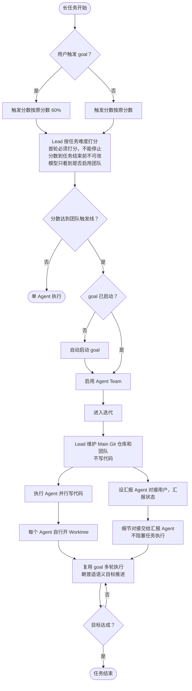

# auto-team 设计说明

## 缘起

做这个仓库，是因为我发现任务慢的很大一个原因：AI 不愿意同时开可能冲突的任务，最后把本来能并行的活排成单 Agent 串行。

auto-team 想把长任务拆开，交给多个 Agent 并行完成。每个 Agent 针对自己的任务开 Worktree，Lead Agent 维护 Main Git 仓库和团队。

## 三个阶段

长任务的全流程是首轮 init、迭代、任务的设置与结束。

### 首轮：init

Lead 在首轮根据任务难度自动判断是否需要 Agent Team。判断通过打分完成：首轮必须完成打分，没有分数就不能停止。

分数由运行时保存，模型只看到是否启用团队，看不到具体数值。分数一旦确定，在任务结束前不能修改。

不给模型看分数，是因为有的模型会故意报高或报低，以此触发或不触发团队。

### 迭代

确定使用 Agent Team 后，Lead Agent 维护 Main Git 仓库和团队，不写任何代码。代码全部由其他 Agent 负责。

团队里设一个汇报 Agent，专门和用户对接，汇报团队状态。用户要问进度、确认细节，都通过它。

多个 Agent 并行执行。每个 Agent 针对自己的任务自行开 Worktree，不和其他 Agent 共用一个工作区。

### 任务的设置与结束

任务的设置就是确定这个任务在普适语义上的目标，也就是它在通常理解下要达成的结果。任务开始后朝这个目标推进，目标达成后，任务结束。

执行中出现的细节对接问题交给汇报 Agent。执行 Agent 不等待这些确认，任务继续推进。

## 评分与 goal

auto-team 的多轮连续执行完全复用 goal 的机制，不另写一套循环。

长任务开始时只有两种状态：用户已经触发 goal，或者没有 goal。

如果用户没有 goal，但选择了 team，auto-team 会自动启动 goal。

用户手动触发 goal 时，团队触发分数按原本分数的 60% 计算。

## 流程图

